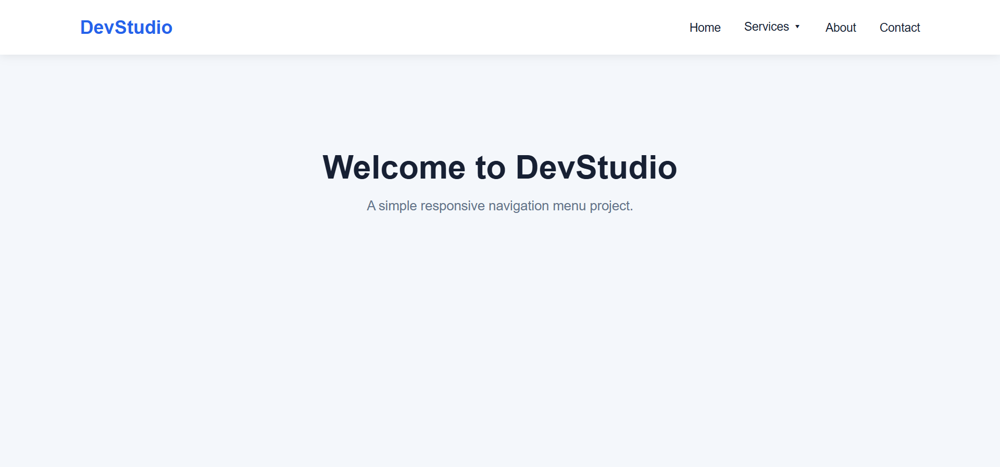
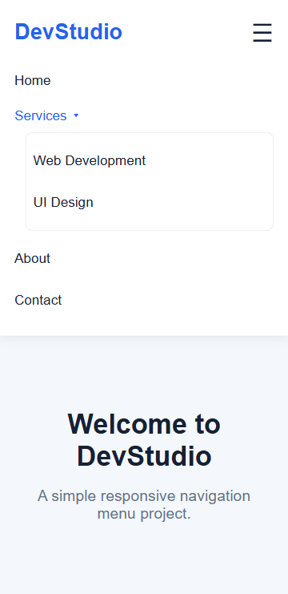

# Responsive Navigation Menu

A responsive navigation menu built using HTML5, CSS3, and vanilla JavaScript.

## Live Demo

https://vikram-student.github.io/responsive-navigation-menu/

## Screenshots

### Desktop View

### Mobile View

## Features

- Responsive desktop and mobile navigation
- Hamburger menu toggle
- Services dropdown menu
- Keyboard interaction using Enter, Space, and Escape
- Close-on-outside-click behavior
- ARIA labels and expanded-state attributes
- Responsive styling for narrow screens

## Technologies

- HTML5
- CSS3
- JavaScript

## Run Locally

1. Clone or download this repository.
2. Open `index.html` in a browser.
3. Resize the browser to test the layout and navigation behavior.

## Testing Status

The project has been manually tested for basic responsive behavior, keyboard interactions, and console errors. Comprehensive accessibility compliance and full cross-browser testing have not been independently verified.
